# ERD — TeleHeart

| | |
|---|---|
| Versi | 1.0 (Draft untuk disepakati tim) |
| Tanggal | 2 November 2026 |
| Database | Supabase PostgreSQL (menggantikan rencana awal MySQL) |
| Dokumen terkait | `PRD.md` |

**Konvensi**: nama tabel dan kolom `snake_case`; PK bertipe `uuid` (default `gen_random_uuid()`) kecuali disebutkan lain; waktu bertipe `timestamptz`; nominal uang dalam **Rupiah bulat** (`integer`); `PK` = primary key, `FK` = foreign key, `UK` = unique.

---

## 1. Diagram ERD

```mermaid
erDiagram
  users ||--o| patient_profiles : "profil pasien"
  users ||--o| doctor_profiles : "profil dokter"
  users ||--o{ consents : "menyetujui"
  users ||--o{ patient_medical_histories : "punya"
  users ||--o{ patient_medications : "punya"
  users ||--o{ patient_allergies : "punya"
  users ||--o{ doctor_tariffs : "menetapkan"
  users ||--o{ platform_fees : "admin menetapkan"
  users ||--o{ consultations : "sebagai pasien"
  users ||--o{ consultations : "sebagai dokter"
  consultations ||--o{ consultation_assignments : "riwayat penugasan"
  users ||--o{ consultation_assignments : "ditawari"
  consultations ||--o| vital_signs : "memiliki"
  consultations ||--o{ chat_messages : "berisi"
  users ||--o{ chat_messages : "mengirim"
  consultations ||--o{ payments : "dibayar lewat"
  consultations ||--o| prescriptions : "menghasilkan"
  prescriptions ||--|{ prescription_items : "berisi obat"
  users ||--o{ prediction_logs : "melakukan prediksi"
  users ||--o{ notifications : "menerima"
  users ||--o{ device_tokens : "memiliki perangkat"
  users ||--o{ audit_logs : "pelaku aksi"

  users {
    uuid id PK "sama dengan auth.users.id"
    user_role role
    text full_name
    text email UK
    boolean is_active
    timestamptz created_at
  }
  consents {
    uuid id PK
    uuid user_id FK
    text consent_type
    text version
    timestamptz accepted_at
  }
  patient_profiles {
    uuid user_id PK, FK
    text nik_encrypted
    text nik_hash UK
    date birth_date
    gender gender
    text phone
    boolean has_prior_hospital_checkup
  }
  patient_medical_histories {
    uuid id PK
    uuid patient_id FK
    text condition_name
    smallint diagnosed_year
    text notes
  }
  patient_medications {
    uuid id PK
    uuid patient_id FK
    text medicine_name
    text dosage
    text frequency
  }
  patient_allergies {
    uuid id PK
    uuid patient_id FK
    text allergen
    text reaction
  }
  doctor_profiles {
    uuid user_id PK, FK
    text str_number UK
    text sip_number
    text specialization
    verification_status verification_status
    uuid verified_by FK
    boolean is_online
  }
  doctor_tariffs {
    uuid id PK
    uuid doctor_id FK
    smallint duration_minutes
    integer price
    boolean is_active
  }
  platform_fees {
    uuid id PK
    integer amount
    timestamptz effective_from
    uuid created_by FK
  }
  consultations {
    uuid id PK
    uuid patient_id FK
    uuid doctor_id FK
    smallint duration_minutes
    integer doctor_fee
    integer platform_fee
    integer total_amount
    consultation_status status
    smallint reassign_count
    timestamptz response_deadline_at
    timestamptz started_at
    timestamptz expires_at
    timestamptz ended_at
  }
  consultation_assignments {
    uuid id PK
    uuid consultation_id FK
    uuid doctor_id FK
    assignment_status status
    timestamptz offered_at
    timestamptz deadline_at
  }
  vital_signs {
    uuid id PK
    uuid consultation_id FK, UK
    uuid patient_id FK
    smallint systolic
    smallint diastolic
    smallint heart_rate
    boolean is_emergency
    timestamptz measured_at
  }
  chat_messages {
    uuid id PK
    uuid consultation_id FK
    uuid sender_id FK
    message_type message_type
    text body
    text attachment_path
    timestamptz created_at
    timestamptz read_at
  }
  payments {
    uuid id PK
    uuid consultation_id FK
    text mayar_payment_id UK
    integer amount
    payment_status status
    timestamptz paid_at
  }
  prescriptions {
    uuid id PK
    uuid consultation_id FK, UK
    uuid doctor_id FK
    uuid patient_id FK
    prescription_status status
    text verification_code UK
    timestamptz issued_at
  }
  prescription_items {
    uuid id PK
    uuid prescription_id FK
    text medicine_name
    text dosage
    text instructions
    text quantity
  }
  prediction_logs {
    uuid id PK
    uuid patient_id FK
    prediction_result result
    text model_version
    timestamptz created_at
  }
  notifications {
    uuid id PK
    uuid user_id FK
    text type
    boolean is_read
    timestamptz created_at
  }
  device_tokens {
    uuid id PK
    uuid user_id FK
    text fcm_token UK
    text platform
  }
  audit_logs {
    bigint id PK
    uuid actor_id FK
    text action
    text resource_type
    uuid patient_id
    timestamptz created_at
  }
```

> Diagram hanya menampilkan kolom kunci. Seluruh kolom ada di kamus data (bagian 3).

---

## 2. Tipe Enum

| Enum | Nilai |
|---|---|
| `user_role` | `patient`, `doctor`, `admin` |
| `gender` | `male`, `female` |
| `verification_status` | `pending`, `approved`, `rejected` |
| `consultation_status` | `draft`, `waiting_payment`, `waiting_doctor`, `active`, `closed`, `cancelled` |
| `assignment_status` | `offered`, `accepted`, `timeout`, `declined` |
| `payment_status` | `pending`, `paid`, `expired`, `failed`, `refunded` |
| `message_type` | `text`, `image` |
| `prescription_status` | `draft`, `issued` |
| `prediction_result` | `at_risk`, `not_at_risk` |

---

## 3. Kamus Data

### 3.1 `users`
Akun semua peran. `id` sama dengan `auth.users.id` milik Supabase Auth (email, password, dan verifikasi email dikelola Supabase Auth).

| Kolom | Tipe | Keterangan |
|---|---|---|
| id | uuid PK | FK ke `auth.users.id` |
| role | user_role | NOT NULL |
| full_name | text | NOT NULL; untuk pasien sesuai KK |
| email | text UK | NOT NULL |
| is_active | boolean | default `true`; admin dapat menonaktifkan |
| created_at, updated_at | timestamptz | default `now()` |

### 3.2 `consents`
| Kolom | Tipe | Keterangan |
|---|---|---|
| id | uuid PK | |
| user_id | uuid FK → users | NOT NULL |
| consent_type | text | `privacy_policy`, `medical_data_processing` |
| version | text | Versi naskah persetujuan |
| accepted_at | timestamptz | NOT NULL |
| ip_address | inet | Opsional |

### 3.3 `patient_profiles`
Relasi 1:1 dengan `users` (role pasien).

| Kolom | Tipe | Keterangan |
|---|---|---|
| user_id | uuid PK, FK → users | |
| nik_encrypted | text | NIK terenkripsi, NOT NULL |
| nik_hash | text UK | Hash NIK (untuk cek duplikasi tanpa membuka NIK) |
| birth_date | date | NOT NULL |
| gender | gender | NOT NULL |
| phone | text | Opsional |
| has_prior_hospital_checkup | boolean | Informasi saja, alur tidak berbeda |
| created_at, updated_at | timestamptz | |

### 3.4 `patient_medical_histories`
| Kolom | Tipe | Keterangan |
|---|---|---|
| id | uuid PK | |
| patient_id | uuid FK → users | NOT NULL |
| condition_name | text | NOT NULL |
| diagnosed_year | smallint | Opsional |
| notes | text | Opsional |
| created_at | timestamptz | |

### 3.5 `patient_medications` (obat rutin)
| Kolom | Tipe | Keterangan |
|---|---|---|
| id | uuid PK | |
| patient_id | uuid FK → users | NOT NULL |
| medicine_name | text | NOT NULL |
| dosage | text | |
| frequency | text | Aturan/frekuensi minum |
| created_at | timestamptz | |

### 3.6 `patient_allergies`
| Kolom | Tipe | Keterangan |
|---|---|---|
| id | uuid PK | |
| patient_id | uuid FK → users | NOT NULL |
| allergen | text | NOT NULL |
| reaction | text | Opsional |
| created_at | timestamptz | |

### 3.7 `doctor_profiles`
Relasi 1:1 dengan `users` (role dokter).

| Kolom | Tipe | Keterangan |
|---|---|---|
| user_id | uuid PK, FK → users | |
| str_number | text UK | NOT NULL |
| sip_number | text | NOT NULL |
| specialization | text | default `'Kardiologi'` |
| workplace | text | Opsional |
| bio | text | Opsional |
| photo_path | text | Path di Storage |
| str_file_path | text | Dokumen STR (bucket private) |
| sip_file_path | text | Dokumen SIP (bucket private) |
| verification_status | verification_status | default `pending` |
| verified_by | uuid FK → users | Admin yang memverifikasi |
| verified_at | timestamptz | |
| rejection_reason | text | Terisi jika ditolak |
| is_online | boolean | default `false` |
| last_seen_at | timestamptz | |
| created_at, updated_at | timestamptz | |

### 3.8 `doctor_tariffs`
| Kolom | Tipe | Keterangan |
|---|---|---|
| id | uuid PK | |
| doctor_id | uuid FK → users | NOT NULL |
| duration_minutes | smallint | CHECK IN (15, 30, 60) |
| price | integer | Rupiah, CHECK ≥ 0 |
| is_active | boolean | default `true` |
| updated_at | timestamptz | |

UNIQUE (`doctor_id`, `duration_minutes`).

### 3.9 `platform_fees`
Riwayat tarif platform. Tarif berlaku = baris dengan `effective_from` terbaru yang ≤ sekarang.

| Kolom | Tipe | Keterangan |
|---|---|---|
| id | uuid PK | |
| amount | integer | Rupiah, CHECK ≥ 0 |
| effective_from | timestamptz | Mulai berlaku |
| created_by | uuid FK → users | Admin |
| note | text | Opsional |
| created_at | timestamptz | |

### 3.10 `consultations`
Satu sesi pemeriksaan dari pasien ke dokter.

| Kolom | Tipe | Keterangan |
|---|---|---|
| id | uuid PK | |
| patient_id | uuid FK → users | NOT NULL |
| doctor_id | uuid FK → users | Dokter saat ini; NULL pada `draft` |
| duration_minutes | smallint | CHECK IN (15, 30, 60); terisi saat checkout |
| doctor_fee | integer | Snapshot tarif dokter saat checkout |
| platform_fee | integer | Snapshot tarif platform saat checkout |
| total_amount | integer | `doctor_fee + platform_fee`; tidak berubah setelah dibayar |
| status | consultation_status | default `draft` |
| complaint | text | Keluhan utama pasien |
| reassign_count | smallint | default `0`; maksimal 3 |
| response_deadline_at | timestamptz | Batas respons dokter (15 menit) |
| started_at | timestamptz | Saat dokter menekan Terima |
| expires_at | timestamptz | `started_at + duration_minutes` |
| ended_at | timestamptz | |
| closed_by | uuid FK → users | NULL jika ditutup otomatis |
| close_reason | text | `doctor_closed`, `time_up`, `no_doctor`, `payment_expired`, `patient_cancelled` |
| doctor_summary | text | Ringkasan/catatan dokter saat menutup sesi |
| created_at, updated_at | timestamptz | |

Aturan: **partial unique index** pada `patient_id` untuk `status IN ('waiting_payment','waiting_doctor','active')` agar pasien hanya punya satu konsultasi berjalan.

### 3.11 `consultation_assignments`
Riwayat penawaran konsultasi ke dokter (untuk timeout dan penggantian dokter).

| Kolom | Tipe | Keterangan |
|---|---|---|
| id | uuid PK | |
| consultation_id | uuid FK → consultations | NOT NULL |
| doctor_id | uuid FK → users | NOT NULL |
| status | assignment_status | default `offered` |
| offered_at | timestamptz | |
| deadline_at | timestamptz | `offered_at + 15 menit` |
| responded_at | timestamptz | |

### 3.12 `vital_signs`
Satu set tanda vital per konsultasi (1:1).

| Kolom | Tipe | Keterangan |
|---|---|---|
| id | uuid PK | |
| consultation_id | uuid FK → consultations, UK | NOT NULL |
| patient_id | uuid FK → users | NOT NULL |
| systolic | smallint | mmHg, wajib |
| diastolic | smallint | mmHg, wajib |
| heart_rate | smallint | BPM, wajib |
| spo2 | smallint | %, opsional |
| weight_kg | numeric(5,2) | Opsional |
| height_cm | numeric(5,2) | Opsional |
| temperature_c | numeric(4,1) | Opsional |
| symptoms | text[] | Daftar gejala yang dipilih |
| notes | text | Catatan bebas |
| is_emergency | boolean | `true` jika melewati ambang darurat |
| emergency_reasons | text[] | Alasan penanda darurat |
| measured_at | timestamptz | Waktu pengukuran |
| created_at | timestamptz | |

### 3.13 `chat_messages`
| Kolom | Tipe | Keterangan |
|---|---|---|
| id | uuid PK | |
| consultation_id | uuid FK → consultations | NOT NULL |
| sender_id | uuid FK → users | NOT NULL |
| message_type | message_type | `text` atau `image` |
| body | text | Isi pesan teks |
| attachment_path | text | Path gambar di Storage |
| attachment_mime | text | `image/jpeg`, `image/png` |
| created_at | timestamptz | |
| read_at | timestamptz | NULL jika belum dibaca |

CHECK: `body` terisi untuk `text`, `attachment_path` terisi untuk `image`.

### 3.14 `payments`
Satu konsultasi dapat memiliki beberapa percobaan pembayaran (invoice kedaluwarsa lalu dibuat ulang).

| Kolom | Tipe | Keterangan |
|---|---|---|
| id | uuid PK | |
| consultation_id | uuid FK → consultations | NOT NULL |
| mayar_payment_id | text UK | ID invoice dari Mayar |
| payment_url | text | Tautan bayar |
| amount | integer | Rupiah |
| status | payment_status | default `pending` |
| payment_method | text | Dari webhook |
| expires_at | timestamptz | |
| paid_at | timestamptz | |
| refunded_at | timestamptz | |
| refunded_by | uuid FK → users | Admin |
| refund_note | text | |
| raw_webhook | jsonb | Payload webhook terakhir (audit dan debug) |
| created_at, updated_at | timestamptz | |

### 3.15 `prescriptions`
| Kolom | Tipe | Keterangan |
|---|---|---|
| id | uuid PK | |
| consultation_id | uuid FK → consultations, UK | Maksimal satu resep per konsultasi |
| doctor_id | uuid FK → users | NOT NULL |
| patient_id | uuid FK → users | NOT NULL |
| notes | text | Catatan umum resep |
| status | prescription_status | default `draft` |
| issued_at | timestamptz | Terisi saat diterbitkan |
| pdf_path | text | PDF di Storage (dibuat saat terbit) |
| verification_code | text UK | Kode untuk QR verifikasi |
| created_at | timestamptz | |

### 3.16 `prescription_items`
Format baku isi resep (diketik bebas oleh dokter).

| Kolom | Tipe | Keterangan |
|---|---|---|
| id | uuid PK | |
| prescription_id | uuid FK → prescriptions | NOT NULL, ON DELETE CASCADE |
| medicine_name | text | Nama obat |
| dosage | text | Dosis |
| instructions | text | Aturan pakai |
| quantity | text | Jumlah (misal "10 tablet") |
| notes | text | Catatan per obat |
| sort_order | smallint | Urutan tampil |

### 3.17 `prediction_logs`
Riwayat prediksi mandiri. **Tidak dapat dibaca dokter maupun admin.** Kolom fitur mengikuti dataset Framingham dan akan disesuaikan dengan daftar fitur final di dokumen pemodelan.

| Kolom | Tipe | Keterangan |
|---|---|---|
| id | uuid PK | |
| patient_id | uuid FK → users | NOT NULL |
| male | boolean | Jenis kelamin |
| age | smallint | |
| education | smallint | 1–4 (sesuai dataset) |
| current_smoker | boolean | |
| cigs_per_day | smallint | |
| bp_meds | boolean | Mengonsumsi obat tekanan darah |
| prevalent_stroke | boolean | |
| prevalent_hyp | boolean | |
| diabetes | boolean | |
| total_cholesterol | numeric(6,2) | mg/dL |
| sys_bp | numeric(5,1) | mmHg |
| dia_bp | numeric(5,1) | mmHg |
| bmi | numeric(5,2) | |
| heart_rate | numeric(5,1) | BPM |
| glucose | numeric(6,2) | mg/dL |
| result | prediction_result | `at_risk` / `not_at_risk` (tanpa probabilitas) |
| model_version | text | Versi model yang dipakai |
| created_at | timestamptz | |

### 3.18 `notifications`
| Kolom | Tipe | Keterangan |
|---|---|---|
| id | uuid PK | |
| user_id | uuid FK → users | Penerima |
| type | text | `consultation_incoming`, `consultation_accepted`, `new_message`, `payment_status`, `doctor_timeout`, `prescription_issued`, `doctor_verification`, `session_closing`, `session_closed` |
| title | text | |
| body | text | Tidak memuat isi medis/isi chat |
| data | jsonb | Mis. `{ "consultation_id": "..." }` |
| is_read | boolean | default `false` |
| created_at | timestamptz | |

### 3.19 `device_tokens`
| Kolom | Tipe | Keterangan |
|---|---|---|
| id | uuid PK | |
| user_id | uuid FK → users | |
| fcm_token | text UK | |
| platform | text | default `'android'` |
| last_seen_at | timestamptz | |
| created_at | timestamptz | |

### 3.20 `audit_logs`
Hanya dapat ditambah (append-only). Tidak berisi isi data medis, hanya jejak akses.

| Kolom | Tipe | Keterangan |
|---|---|---|
| id | bigint PK | Identity |
| actor_id | uuid FK → users | NULL jika dilakukan sistem |
| actor_role | user_role | |
| action | text | Mis. `view_patient_profile`, `view_vitals`, `view_history`, `view_chat`, `issue_prescription`, `download_prescription`, `approve_doctor`, `change_platform_fee`, `mark_refund` |
| resource_type | text | Mis. `consultation`, `prescription` |
| resource_id | uuid | |
| patient_id | uuid | Pasien yang datanya diakses (jika ada) |
| metadata | jsonb | Info tambahan non-medis |
| ip_address | inet | |
| created_at | timestamptz | |

---

## 4. Ringkasan Relasi

| Relasi | Kardinalitas | Keterangan |
|---|---|---|
| users – patient_profiles | 1 : 0..1 | Hanya untuk role pasien |
| users – doctor_profiles | 1 : 0..1 | Hanya untuk role dokter |
| users – consents | 1 : N | |
| users (pasien) – riwayat penyakit / obat rutin / alergi | 1 : N | |
| users (dokter) – doctor_tariffs | 1 : N (maks. 3 aktif) | Satu per durasi |
| users (admin) – platform_fees | 1 : N | Riwayat perubahan |
| users (pasien) – consultations | 1 : N | |
| users (dokter) – consultations | 1 : N | Dokter saat ini |
| consultations – consultation_assignments | 1 : N | Riwayat penugasan dan pergantian dokter |
| consultations – vital_signs | 1 : 0..1 | |
| consultations – chat_messages | 1 : N | |
| consultations – payments | 1 : N | Beberapa percobaan bayar |
| consultations – prescriptions | 1 : 0..1 | |
| prescriptions – prescription_items | 1 : 1..N | |
| users (pasien) – prediction_logs | 1 : N | Tidak terkait konsultasi |
| users – notifications, device_tokens, audit_logs | 1 : N | |

---

## 5. Aturan Akses (Row Level Security)

| Tabel | Pasien | Dokter | Admin |
|---|---|---|---|
| users | Baca/ubah diri sendiri | Baca/ubah diri sendiri; baca nama pasien yang ditugaskan | Baca semua (tanpa data medis), ubah `is_active` |
| consents | Baca/tambah milik sendiri | — | Baca |
| patient_profiles, riwayat penyakit, obat rutin, alergi | Baca/ubah milik sendiri | Baca jika ada assignment `offered`/`accepted` atau pernah ditangani | **Tidak ada** |
| doctor_profiles | Baca (dokter approved) | Baca/ubah milik sendiri | Baca semua, ubah verifikasi |
| doctor_tariffs | Baca (dokter approved) | Baca/ubah milik sendiri | Baca |
| platform_fees | Baca (nilai berlaku) | Baca | Baca/tambah |
| consultations | Baca milik sendiri | Baca yang ditugaskan kepadanya | Baca metadata (tanpa `complaint`, `doctor_summary`)* |
| consultation_assignments | Baca milik sendiri | Baca/ubah miliknya | Baca |
| vital_signs | Baca/tambah milik sendiri | Baca (pasien yang ditugaskan, termasuk riwayat) | **Tidak ada** |
| chat_messages | Peserta sesi | Peserta sesi | **Tidak ada** |
| payments | Baca milik sendiri | Baca sesi miliknya | Baca, tandai refund |
| prescriptions, prescription_items | Baca milik sendiri | Buat/baca yang diterbitkannya | **Tidak ada** (metadata saja, tanpa isi) |
| prediction_logs | Baca/tambah milik sendiri | **Tidak ada** | **Tidak ada** |
| notifications, device_tokens | Milik sendiri | Milik sendiri | Milik sendiri |
| audit_logs | Tidak ada | Tidak ada | Baca |

\* Karena RLS bekerja per baris, pembatasan kolom untuk admin dilakukan lewat **view** khusus (mis. `admin_consultation_overview`) atau lewat REST API yang hanya mengembalikan kolom metadata.

Penulisan ke `payments` (status), `consultations` (status), `audit_logs`, dan `prescriptions.status = issued` **hanya lewat backend** memakai service role, tidak langsung dari klien.

---

## 6. Supabase Storage (bucket private)

| Bucket | Isi | Akses |
|---|---|---|
| `chat-attachments` | Gambar chat, path `{consultation_id}/{file}` | Peserta konsultasi, signed URL |
| `prescriptions` | PDF resep, path `{patient_id}/{prescription_id}.pdf` | Pasien pemilik dan dokter penerbit, signed URL |
| `doctor-documents` | Dokumen STR/SIP | Dokter pemilik dan admin |
| `doctor-photos` | Foto profil dokter | Publik atau login (opsional) |

---

## 7. Indeks yang Disarankan

| Tabel | Indeks | Tujuan |
|---|---|---|
| consultations | (`patient_id`, `created_at` DESC) | Riwayat pasien |
| consultations | (`doctor_id`, `status`) | Antrean dan sesi aktif dokter |
| consultations | partial UNIQUE (`patient_id`) WHERE status IN (`waiting_payment`,`waiting_doctor`,`active`) | Satu konsultasi berjalan per pasien |
| consultation_assignments | (`status`, `deadline_at`) | Job timeout 15 menit |
| chat_messages | (`consultation_id`, `created_at`) | Memuat chat berurutan |
| payments | (`consultation_id`), UNIQUE (`mayar_payment_id`) | Pencocokan webhook |
| doctor_profiles | (`verification_status`, `is_online`) | Daftar dokter dan verifikasi |
| vital_signs | (`patient_id`, `measured_at` DESC) | Riwayat tanda vital |
| prediction_logs | (`patient_id`, `created_at` DESC) | Riwayat prediksi |
| notifications | (`user_id`, `is_read`, `created_at` DESC) | Daftar notifikasi |
| audit_logs | (`patient_id`, `created_at` DESC), (`actor_id`, `created_at` DESC) | Telusur akses |

---

## 8. Catatan Perancangan

1. **Snapshot harga.** `doctor_fee`, `platform_fee`, dan `total_amount` disalin ke `consultations` saat checkout. Perubahan tarif oleh dokter/admin tidak memengaruhi konsultasi yang sudah berjalan.
2. **Penggantian dokter.** `consultations.doctor_id` selalu menunjuk dokter saat ini, sedangkan seluruh penawaran sebelumnya tercatat di `consultation_assignments` (`timeout`, `declined`, `accepted`).
3. **Idempotensi webhook.** Pencocokan memakai `payments.mayar_payment_id`. Pembaruan status diabaikan jika status sudah final (`paid`, `refunded`).
4. **NIK.** Disimpan terenkripsi di `nik_encrypted`. `nik_hash` dipakai untuk memastikan satu NIK hanya terdaftar satu kali tanpa membuka nilai aslinya.
5. **Riwayat pemeriksaan untuk dokter.** Dibentuk dari `consultations` + `vital_signs` + `prescriptions` + `doctor_summary` milik pasien. Isi `chat_messages` dari dokter lain tidak dibuka.
6. **Prediksi terpisah dari konsultasi.** `prediction_logs` tidak memiliki FK ke `consultations`, sesuai keputusan bahwa fitur ini berdiri sendiri dan tidak dilihat dokter.
7. **Fitur prediksi.** Kolom `prediction_logs` mengikuti dataset Framingham dan perlu diselaraskan jika fitur final berubah setelah proses pemodelan.
8. **Job terjadwal** (tiap menit): (a) tandai `consultation_assignments` yang melewati `deadline_at` sebagai `timeout` lalu tawarkan ke dokter lain, (b) tutup sesi `active` yang melewati `expires_at`, (c) tandai invoice `pending` yang melewati `expires_at` sebagai `expired`.
