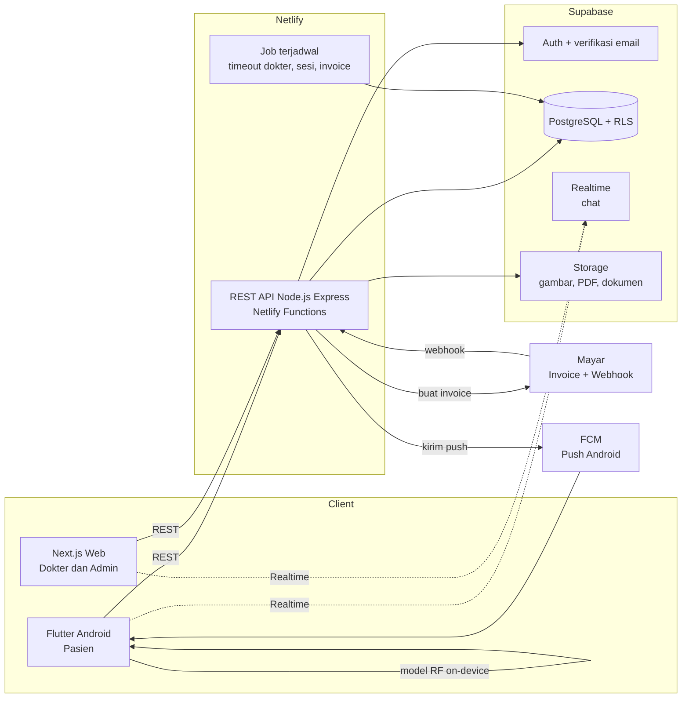
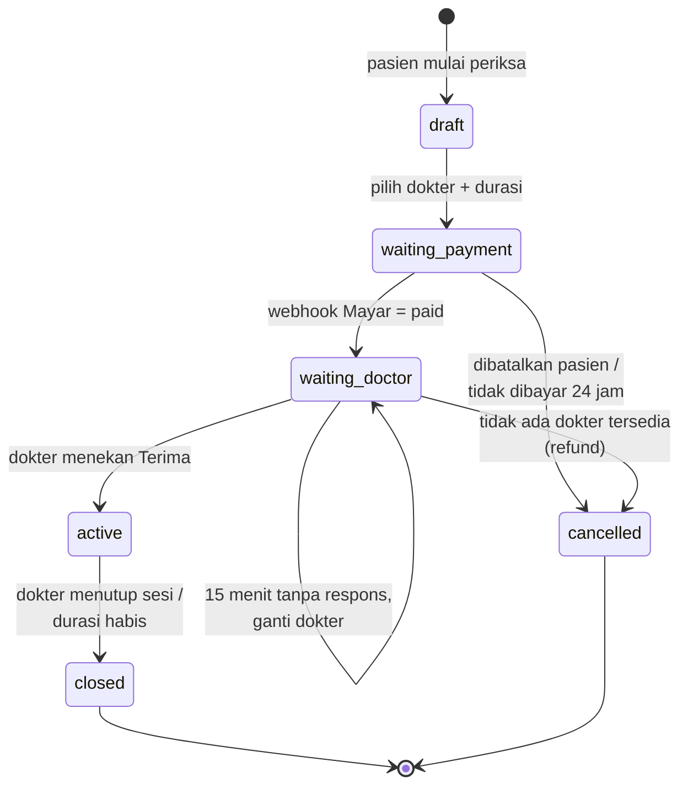

# PRD — TeleHeart

**Telehealth Konsultasi Jantung dengan Fitur Prediksi Risiko**

| | |
|---|---|
| Versi | 1.0 (Draft untuk disepakati tim) |
| Tanggal | 2 November 2026 |
| Target pengumpulan | Jumat, 6 November 2026 |
| Dokumen terkait | `ERD.md` (struktur database), `API.md` (kontrak REST API), dokumen pemodelan AI (file terpisah) |

> Dokumen ini mencakup **seluruh sistem** (backend, web dokter/admin, dan mobile pasien) dan menjadi acuan bersama ketiga bagian tim. Isinya **alur dan kebutuhan sistem**. Kode dan langkah pemodelan AI ada di file terpisah.

---

## 1. Ringkasan Produk

TeleHeart adalah platform telehealth khusus **pemeriksaan jantung**. Pasien berkonsultasi lewat chat 1:1 dengan dokter, membayar lewat Mayar, lalu menerima resep digital berbentuk PDF. Pasien yang sudah pernah periksa jantung di rumah sakit dapat memakai TeleHeart untuk kontrol lanjutan dari rumah, sedangkan pasien yang belum pernah ke rumah sakit juga dapat mencoba layanan ini.

Selain alur konsultasi, tersedia **fitur prediksi risiko penyakit jantung** yang berdiri sendiri. Pasien dapat menjalankannya mandiri kapan saja dan hasilnya hanya berupa **"Berisiko"** atau **"Tidak berisiko"**.

| Platform | Pengguna | Teknologi |
|---|---|---|
| Aplikasi mobile (Android) | Pasien | Flutter |
| Website | Dokter dan Admin | Next.js |
| Backend | Semua | REST API (Node.js), Supabase |

## 2. Tujuan dan Ruang Lingkup

### 2.1 Tujuan
1. Pasien dapat berkonsultasi dengan dokter jantung secara online, aman, dan terbayar sebelum sesi dimulai.
2. Dokter mendapat data tanda vital dan riwayat pemeriksaan pasien sebelum dan selama konsultasi.
3. Admin dapat mengelola akun, verifikasi dokter, tarif platform, dan transaksi tanpa melihat data medis.
4. Pasien dapat mengecek risiko jantung secara mandiri lewat model AI yang berjalan di perangkat.

### 2.2 Dalam Lingkup (harus selesai untuk pengumpulan)
- Registrasi, verifikasi email, consent, login (pasien, dokter, admin)
- Profil kesehatan pasien (riwayat penyakit, obat rutin, alergi)
- Input tanda vital per pemeriksaan dengan peringatan darurat
- Daftar dokter online, pilihan durasi (15/30/60 menit), tarif dinamis
- Pembayaran via Mayar (invoice + webhook), timeout respons dokter 15 menit dan penggantian dokter
- Chat real-time 1:1 (teks dan gambar), sesi ditutup oleh dokter
- Resep (format terstruktur) dan unduh PDF dengan QR verifikasi
- Riwayat pemeriksaan pasien, dapat dilihat dokter pada pemeriksaan berikutnya
- Prediksi risiko jantung (Random Forest, dataset Framingham, on-device) dengan riwayat di server
- Notifikasi FCM (Android) dan notifikasi in-app (web)
- Dashboard admin, audit log, consent

### 2.3 Di Luar Lingkup
- Pemantauan tanda vital harian di luar sesi pemeriksaan (dibatalkan)
- Voice call dan video call
- Integrasi dengan sistem rumah sakit (SIMRS) atau apotek
- iOS
- Master data obat (resep diketik bebas dalam format baku)
- Pencairan dana ke dokter secara otomatis (sistem hanya mencatat transaksi)

---

## 3. Aktor dan Hak Akses

| Aktor | Akses | Deskripsi |
|---|---|---|
| **Pasien** | Mobile | Mengisi data, memulai pemeriksaan, chat, membayar, mengunduh resep, memakai prediksi |
| **Dokter** | Web | Mendaftar, diverifikasi admin, mengatur tarif dan status online, menerima dan menutup sesi, menulis resep |
| **Admin** | Web | Verifikasi dokter, kelola akun, atur tarif platform, pantau transaksi dan laporan **tanpa akses isi data medis** |

### Matriks akses data

| Data | Pasien | Dokter | Admin |
|---|---|---|---|
| Akun dan profil sendiri | Baca/Ubah | Baca/Ubah | Baca/Ubah |
| Profil kesehatan pasien | Baca/Ubah (milik sendiri) | Baca (pasien yang ditugaskan) | Tidak ada |
| Tanda vital dan riwayat periksa | Baca (milik sendiri) | Baca (pasien yang ditugaskan) | Tidak ada |
| Isi chat | Peserta sesi | Peserta sesi | Tidak ada |
| Resep | Baca/Unduh (milik sendiri) | Buat/Baca (yang diterbitkannya) | Tidak ada (hanya metadata) |
| Riwayat prediksi AI | Baca (milik sendiri) | Tidak ada | Tidak ada |
| Tarif dokter | Lihat | Ubah (milik sendiri) | Lihat |
| Tarif platform | Lihat (sebagai bagian harga) | Lihat | Ubah |
| Transaksi | Baca (milik sendiri) | Baca (sesi miliknya) | Baca metadata, tandai refund |
| Audit log | Tidak ada | Tidak ada | Baca |

Pembatasan ini **diterapkan di backend dan database (Row Level Security Supabase)**, bukan hanya disembunyikan di tampilan.

---

## 4. Arsitektur dan Teknologi

| Komponen | Teknologi | Catatan |
|---|---|---|
| Mobile | Flutter (Android) | `supabase_flutter`, `firebase_messaging`, model prediksi dibundel di aplikasi |
| Web | Next.js | Dashboard dokter dan admin; memanggil REST API |
| REST API | Node.js + Express (`serverless-http`) | Repo backend sendiri, dideploy sebagai Netlify Functions; kontrak lengkap di `API.md` |
| Database | Supabase PostgreSQL | Menggantikan rencana awal MySQL |
| Autentikasi | Supabase Auth | Email + password, verifikasi email |
| Chat real-time | Supabase Realtime | Kirim lewat REST API, terima lewat Realtime |
| File | Supabase Storage (private bucket) | Gambar chat, PDF resep, dokumen STR/SIP |
| Pembayaran | Mayar | Invoice per sesi, status dari webhook |
| Push notification | Firebase Cloud Messaging | Android |
| Job terjadwal | Function terjadwal terpisah (bukan Express) atau Supabase `pg_cron` | Timeout respons dokter, kedaluwarsa invoice, penutupan sesi otomatis |
| Repositori (disarankan) | Tiga repo: `teleheart-backend`, `teleheart-web`, `teleheart-mobile` | Terhubung lewat URL API dan kontrak `API.md`; satu project Supabase dipakai bersama |

---

## 5. Alur Bisnis Utama

### 5.1 Alur Pasien (end-to-end)

1. **Registrasi**: isi nama (sesuai KK), NIK, email, password, lalu setujui consent. Sistem mengirim email verifikasi.
2. **Login** setelah email terverifikasi, lalu lengkapi **profil kesehatan** (riwayat penyakit, obat rutin, alergi).
3. **Mulai pemeriksaan**: pasien mengisi **tanda vital dan keluhan**.
   - Jika ada nilai berbahaya, muncul **peringatan darurat** dan tombol **"Hubungi IGD"**. Pasien tetap dapat melanjutkan konsultasi.
4. **Pilih dokter** dari daftar dokter online, lalu pilih **durasi** (15 / 30 / 60 menit). Harga total ditampilkan.
5. **Bayar** lewat halaman invoice Mayar. Status berubah setelah webhook diterima.
6. **Menunggu dokter**. Dokter menerima notifikasi dan menekan "Terima". Jika dalam **15 menit** tidak ada respons, sistem menugaskan **dokter lain** dengan rentang harga yang sama.
7. **Chat 1:1** (teks dan gambar) selama durasi yang dibeli.
8. **Dokter menutup sesi** dan menerbitkan **resep** (jika diperlukan). Riwayat chat menjadi read-only.
9. Pasien **mengunduh resep PDF** dan melihat riwayat pemeriksaan.

### 5.2 Alur Dokter

1. Daftar (email, password, data STR/SIP, unggah dokumen) → status **menunggu verifikasi**.
2. Admin menyetujui atau menolak. Setelah **disetujui**, dokter dapat mengatur **tarif** (15/30/60 menit) dan status **online**.
3. Dokter menerima permintaan konsultasi (setelah pasien membayar), melihat tanda vital, profil kesehatan, dan riwayat pemeriksaan pasien, lalu menekan **Terima**.
4. Chat dengan pasien. Dokter menutup sesi, mengisi **ringkasan/catatan**, dan menerbitkan **resep**.

### 5.3 Alur Admin
Verifikasi dokter → kelola akun (aktif/nonaktif) → atur tarif platform → pantau transaksi dan tandai refund → lihat laporan ringkas dan audit log.

### 5.4 Status Konsultasi

---

## 6. Kebutuhan Fungsional

### 6.1 Autentikasi dan Akun (FR-AUTH)
| ID | Kebutuhan |
|---|---|
| FR-AUTH-01 | Pasien mendaftar dengan nama (sesuai KK), NIK 16 digit, tanggal lahir, jenis kelamin, email, password. |
| FR-AUTH-02 | Verifikasi email wajib sebelum akun dapat dipakai. |
| FR-AUTH-03 | Halaman **consent** (persetujuan pemrosesan data kesehatan dan kebijakan privasi) wajib disetujui saat registrasi. Persetujuan dicatat beserta versi dan waktunya. |
| FR-AUTH-04 | Dokter mendaftar mandiri dengan nama, email, password, nomor STR, nomor SIP, spesialisasi, dan unggah dokumen STR/SIP. |
| FR-AUTH-05 | Dokter berstatus *pending* dapat login tetapi tidak tampil di daftar dokter dan tidak dapat menerima konsultasi. |
| FR-AUTH-06 | Akun admin dibuat lewat seeding awal (bukan registrasi publik). |
| FR-AUTH-07 | NIK unik per akun dan disimpan terenkripsi. |
| FR-AUTH-08 | Role (pasien/dokter/admin) dibatasi ketat: pasien hanya login di mobile, dokter dan admin di web. |

### 6.2 Profil Kesehatan Pasien (FR-PROF)
| ID | Kebutuhan |
|---|---|
| FR-PROF-01 | Pasien dapat mengisi dan mengubah nomor telepon. Tanggal lahir dan jenis kelamin diisi saat registrasi. |
| FR-PROF-02 | Pasien mengisi **riwayat penyakit**, **obat rutin**, dan **alergi** (boleh lebih dari satu, dapat diubah kapan saja). |
| FR-PROF-03 | Pasien dapat menandai apakah pernah memeriksakan jantung di rumah sakit (informasi saja, alur tetap sama). |

### 6.3 Tanda Vital dan Peringatan Darurat (FR-VIT)
| ID | Kebutuhan |
|---|---|
| FR-VIT-01 | Setiap pemeriksaan memiliki satu set tanda vital: tekanan darah (sistolik/diastolik), detak jantung (BPM) **wajib**; SpO2, berat badan, tinggi badan, suhu **opsional**; keluhan/gejala dan catatan bebas. |
| FR-VIT-02 | Sistem mengevaluasi nilai terhadap ambang darurat (lihat 7.5). Jika terlampaui atau ada gejala berbahaya, tampil **peringatan darurat** dan tombol **Hubungi IGD** (panggilan ke 119 atau 112). |
| FR-VIT-03 | Peringatan darurat tidak memblokir alur konsultasi. Status darurat ditandai di data pemeriksaan sehingga dokter melihatnya. |
| FR-VIT-04 | Tidak ada input tanda vital di luar sesi pemeriksaan. |

### 6.4 Dokter dan Tarif (FR-DOC)
| ID | Kebutuhan |
|---|---|
| FR-DOC-01 | Admin melihat daftar dokter *pending*, memeriksa dokumen STR/SIP, lalu **menyetujui** atau **menolak** (dengan alasan). |
| FR-DOC-02 | Dokter mengatur tarif sendiri untuk tiap durasi (15/30/60 menit). Tarif dapat diubah dokter kapan saja dan berlaku untuk konsultasi berikutnya. |
| FR-DOC-03 | Admin menetapkan **tarif platform** (biaya tetap) yang dapat diubah sewaktu-waktu. Perubahan berlaku ke depan dan riwayat perubahan tersimpan. |
| FR-DOC-04 | Dokter yang disetujui dapat mengubah status **online/offline**. Hanya dokter online dan terverifikasi yang tampil di daftar pasien. |
| FR-DOC-05 | Daftar dokter menampilkan nama, spesialisasi, dan **harga total per durasi** (tarif dokter + tarif platform). |

### 6.5 Konsultasi (FR-KON)
| ID | Kebutuhan |
|---|---|
| FR-KON-01 | Pasien memulai pemeriksaan, mengisi tanda vital, memilih dokter dan durasi. |
| FR-KON-02 | Harga total = tarif dokter (sesuai durasi) + tarif platform, dan **dikunci (snapshot)** saat checkout. |
| FR-KON-03 | Setelah pembayaran lunas, dokter menerima notifikasi dan dapat melihat tanda vital, profil kesehatan, serta riwayat pemeriksaan pasien. |
| FR-KON-04 | Dokter menekan **Terima**, sesi menjadi *active* dan **timer durasi dimulai**. |
| FR-KON-05 | Jika dokter tidak menerima dalam **15 menit**, sistem mencari dokter online lain dengan rentang harga yang sama dan mengirim permintaan baru. Pasien diberi notifikasi. |
| FR-KON-06 | Jika tidak ada dokter pengganti yang tersedia, konsultasi dibatalkan dan pembayaran masuk proses **refund**. |
| FR-KON-07 | Dokter menutup sesi dan mengisi ringkasan/catatan. Sesi juga tertutup otomatis saat durasi habis. |
| FR-KON-08 | Setelah ditutup, chat bersifat **read-only** dan tetap dapat dibaca peserta. |
| FR-KON-09 | Seorang pasien hanya boleh memiliki satu konsultasi aktif/berjalan pada satu waktu. |
| FR-KON-10 | Dokter dapat melihat **riwayat pemeriksaan** pasien (tanda vital, resep, ringkasan dokter) saat menangani konsultasi berikutnya. |

### 6.6 Pembayaran (FR-PAY)
| ID | Kebutuhan |
|---|---|
| FR-PAY-01 | Backend membuat **invoice Mayar** per konsultasi dan mengembalikan tautan pembayaran ke pasien. |
| FR-PAY-02 | Status pembayaran hanya diubah oleh **webhook Mayar** (bukan oleh klien). Webhook divalidasi keasliannya dan diproses secara idempotent. |
| FR-PAY-03 | Status: `pending`, `paid`, `expired`, `failed`, `refunded`. |
| FR-PAY-04 | Chat baru terbuka setelah status `paid` dan dokter menerima sesi. |
| FR-PAY-05 | Jika invoice kedaluwarsa atau gagal, pasien dapat membuat invoice baru selama konsultasi masih `waiting_payment`, atau membatalkan konsultasi. |
| FR-PAY-06 | Refund ditandai oleh admin pada transaksi terkait (misal dokter tidak tersedia), dengan catatan. |

### 6.7 Chat (FR-CHAT)
| ID | Kebutuhan |
|---|---|
| FR-CHAT-01 | Chat 1:1 real-time antara pasien dan dokter dalam satu konsultasi. |
| FR-CHAT-02 | Jenis pesan: **teks** dan **gambar** (misal foto hasil EKG atau lab). Batas ukuran gambar 5 MB, format JPG/PNG. |
| FR-CHAT-03 | Pesan hanya dapat dikirim saat sesi *active*. Validasi dilakukan di backend. |
| FR-CHAT-04 | Gambar disimpan di bucket private dan diakses lewat signed URL berumur pendek. |
| FR-CHAT-05 | Tampilkan sisa waktu sesi dan penanda pesan terbaca. |
| FR-CHAT-06 | Admin tidak memiliki akses ke isi chat. |

### 6.8 Resep (FR-RX)
| ID | Kebutuhan |
|---|---|
| FR-RX-01 | Dokter mengisi resep dengan format baku per baris obat: **nama obat, dosis, aturan pakai, jumlah, catatan** (teks bebas), serta catatan umum resep. |
| FR-RX-02 | Resep diterbitkan dokter pada atau setelah sesi ditutup. Konsultasi boleh tidak memiliki resep. |
| FR-RX-03 | Sistem menghasilkan **PDF** berisi kop TeleHeart, data pasien, nama dokter, nomor STR, tanggal, daftar obat, dan **QR verifikasi**. |
| FR-RX-04 | Pasien dapat mengunduh PDF hanya jika resep **terbit** dan pembayaran **lunas**. |
| FR-RX-05 | QR mengarah ke halaman verifikasi publik yang hanya menampilkan **keabsahan, nama dokter, dan tanggal terbit**, tanpa isi resep. |
| FR-RX-06 | Resep yang sudah terbit tidak dapat diubah. |

### 6.9 Prediksi Risiko Jantung (FR-AI)
| ID | Kebutuhan |
|---|---|
| FR-AI-01 | Fitur berdiri sendiri, diakses dari dashboard pasien lewat tombol **Prediksi**, tidak masuk alur pemeriksaan. |
| FR-AI-02 | Pasien mengisi fitur model (mengikuti dataset Framingham, lihat 8). Data yang sudah ada di profil dapat diisi otomatis. |
| FR-AI-03 | Inferensi berjalan **on-device** di Flutter memakai model Random Forest hasil ekspor dari Colab. |
| FR-AI-04 | Output hanya **Berisiko** atau **Tidak berisiko**, **tanpa nilai probabilitas**. |
| FR-AI-05 | Wajib menampilkan **disclaimer**: hasil bukan diagnosis medis. Jika *Berisiko*, tampilkan anjuran berkonsultasi dengan dokter dan tombol menuju alur pemeriksaan. |
| FR-AI-06 | Input dan hasil prediksi **disimpan di server** sebagai riwayat prediksi pasien. **Dokter dan admin tidak dapat melihatnya.** |

### 6.10 Notifikasi (FR-NOT)
| ID | Kebutuhan | Penerima |
|---|---|---|
| FR-NOT-01 | Konsultasi baru masuk | Dokter |
| FR-NOT-02 | Dokter menerima sesi | Pasien |
| FR-NOT-03 | Pesan baru (isi pesan tidak ditampilkan di push) | Pasien/Dokter |
| FR-NOT-04 | Status pembayaran berubah | Pasien |
| FR-NOT-05 | Dokter tidak merespons, diganti dokter lain | Pasien |
| FR-NOT-06 | Resep terbit | Pasien |
| FR-NOT-07 | Hasil verifikasi dokter | Dokter |
| FR-NOT-08 | Sesi ditutup / durasi hampir habis | Pasien/Dokter |

Pasien menerima push lewat FCM. Dokter dan admin menerima notifikasi in-app di web (Realtime).

### 6.11 Admin (FR-ADM)
| ID | Kebutuhan |
|---|---|
| FR-ADM-01 | Daftar dan verifikasi dokter (lihat dokumen STR/SIP). |
| FR-ADM-02 | Kelola akun pengguna: lihat, aktifkan/nonaktifkan. Tidak menampilkan data medis. |
| FR-ADM-03 | Atur tarif platform dengan riwayat perubahan. |
| FR-ADM-04 | Pantau transaksi (metadata: waktu, jumlah, status, dokter, pasien) dan tandai refund. |
| FR-ADM-05 | Laporan ringkas: jumlah konsultasi, jumlah transaksi per status, total pendapatan, jumlah dokter aktif. |
| FR-ADM-06 | Lihat audit log akses data. |

### 6.12 Keamanan dan Privasi (FR-SEC)
| ID | Kebutuhan |
|---|---|
| FR-SEC-01 | **Audit log** mencatat siapa mengakses data pasien (profil, tanda vital, riwayat, chat, resep), kapan, dan tindakan apa. |
| FR-SEC-02 | Row Level Security aktif di seluruh tabel yang memuat data pengguna. |
| FR-SEC-03 | Semua trafik lewat HTTPS. Bucket Storage bersifat private. |
| FR-SEC-04 | NIK terenkripsi di database. Data medis tidak ditulis ke log aplikasi. |
| FR-SEC-05 | Consent tercatat dan dapat dibuktikan (versi, waktu). |

---

## 7. Aturan Bisnis

| ID | Aturan |
|---|---|
| BR-01 | **Bayar di awal**, chat terbuka setelah pembayaran lunas dan dokter menerima sesi. |
| BR-02 | Harga total = tarif dokter (per durasi) + tarif platform. Nilainya dikunci saat checkout dan **tidak berubah** walau tarif diubah kemudian. |
| BR-03 | Durasi yang tersedia: 15, 30, 60 menit. Timer dimulai saat dokter menekan **Terima**. |
| BR-04 | Dokter yang tidak merespons dalam 15 menit diganti dokter lain dengan rentang harga yang sama (maksimal 3 kali penggantian). Jika gagal, konsultasi dibatalkan dan direfund. |
| BR-05 | Hanya dokter berstatus *approved* dan *online* yang tampil di daftar pasien. |
| BR-06 | Sesi ditutup oleh dokter atau otomatis saat durasi habis. Setelah itu chat read-only. |
| BR-07 | Resep hanya dapat diunduh jika terbit dan pembayaran lunas. |
| BR-08 | Admin tidak dapat melihat isi chat, tanda vital, resep, maupun prediksi. |
| BR-09 | Dokter hanya melihat data pasien yang ditugaskan kepadanya (assignment aktif/diterima, atau pernah ditangani). |
| BR-10 | Pasien hanya boleh memiliki satu konsultasi berjalan dalam satu waktu. |

### 7.5 Ambang Peringatan Darurat (usulan awal)

> **Perlu divalidasi oleh dokter/dosen pembimbing sebelum dipakai di demo.** Nilai disimpan sebagai konstanta konfigurasi agar mudah diubah.

| Parameter | Kondisi darurat |
|---|---|
| Tekanan darah | Sistolik ≥ 180 **atau** diastolik ≥ 120 mmHg |
| Tekanan darah rendah | Sistolik < 90 mmHg |
| Detak jantung | > 120 atau < 40 BPM |
| SpO2 | < 92% |
| Gejala | Nyeri dada, sesak napas berat, pingsan, nyeri menjalar ke lengan/rahang |

---

## 8. Fitur Prediksi Risiko Jantung

| Aspek | Keputusan |
|---|---|
| Dataset | Framingham Heart Study (Kaggle) |
| Algoritma | Random Forest |
| Target | Risiko penyakit jantung koroner 10 tahun (`TenYearCHD`) |
| Output | Berisiko / Tidak berisiko, tanpa probabilitas |
| Eksekusi | On-device di Flutter (model dilatih di Colab, diekspor) |
| Penyimpanan | Input dan hasil disimpan di server (`prediction_logs`), tidak dapat dilihat dokter/admin |
| Disclaimer | Wajib, bukan diagnosis medis |

Fitur masukan yang diperkirakan mengikuti dataset: jenis kelamin, usia, pendidikan, status merokok, rokok per hari, obat tekanan darah, riwayat stroke, hipertensi, diabetes, kolesterol total, tekanan darah sistolik/diastolik, BMI, detak jantung, dan glukosa. **Daftar final fitur ditentukan di dokumen pemodelan**, dan kolom `prediction_logs` di ERD disesuaikan dengan daftar tersebut.

---

## 9. Kebutuhan Non-Fungsional

| Kategori | Kebutuhan |
|---|---|
| Keamanan | HTTPS, RLS, signed URL, validasi webhook, enkripsi NIK, rate limit pada endpoint auth |
| Privasi | Mengikuti prinsip UU PDP: consent eksplisit, pembatasan akses berbasis peran, audit log |
| Kinerja | Pesan chat tampil di lawan bicara kurang dari 2 detik pada koneksi normal; inferensi prediksi kurang dari 1 detik |
| Ketersediaan | Mengandalkan Supabase dan Netlify. Job timeout berjalan tiap menit |
| Kompatibilitas | Android 8.0+; web browser modern (Chrome, Edge, Firefox) |
| Integritas | Webhook idempotent, harga di-snapshot, transisi status divalidasi di backend |
| Usability | Peringatan darurat jelas dan mencolok; UI berbahasa Indonesia |

---

## 10. Daftar Layar

**Mobile (Pasien)**: Splash · Registrasi · Verifikasi email · Consent · Login · Profil kesehatan · Dashboard · Form tanda vital · Peringatan darurat · Pilih dokter dan durasi · Pembayaran (WebView/tautan Mayar) · Menunggu dokter · Ruang chat · Riwayat pemeriksaan · Detail riwayat + unduh resep · Prediksi risiko (form, hasil, riwayat) · Notifikasi · Akun

**Web (Dokter)**: Registrasi · Login · Status verifikasi · Dashboard (permintaan masuk, sesi aktif) · Detail pasien (profil, tanda vital, riwayat) · Ruang chat · Tutup sesi + ringkasan · Form resep · Pengaturan tarif dan status online · Riwayat konsultasi · Notifikasi

**Web (Admin)**: Login · Dashboard laporan · Verifikasi dokter · Manajemen pengguna · Tarif platform · Transaksi · Audit log

---

## 11. Ringkasan REST API

Prefix `/api/v1`. Autentikasi memakai JWT Supabase pada header `Authorization: Bearer`. Detail request/response, format error, dan kode error ada di `API.md`.

| Modul | Endpoint |
|---|---|
| Auth | `POST /auth/register/patient`, `POST /auth/register/doctor`, `POST /auth/login`, `POST /auth/logout`, `POST /auth/resend-verification`, `GET /me` |
| Profil pasien | `GET/PUT /patients/me/profile`, `GET/POST/PUT/DELETE /patients/me/medical-histories`, `/medications`, `/allergies` |
| Dokter | `GET /doctors`, `GET /doctors/:id`, `PUT /doctors/me/profile`, `PATCH /doctors/me/online`, `GET/PUT /doctors/me/tariffs` |
| Konsultasi | `POST /consultations`, `GET /consultations`, `GET /consultations/:id`, `POST /consultations/:id/vitals`, `POST /consultations/:id/checkout`, `POST /consultations/:id/accept`, `POST /consultations/:id/close`, `GET /doctor/queue`, `GET /patients/:id/history` |
| Chat | `GET /consultations/:id/messages`, `POST /consultations/:id/messages`, `POST /consultations/:id/attachments`, `PATCH /consultations/:id/messages/read` |
| Pembayaran | `GET /payments/:id`, `POST /webhooks/mayar` |
| Resep | `POST /consultations/:id/prescription`, `GET /consultations/:id/prescription`, `GET /prescriptions/:id/pdf`, `GET /verify/prescription/:code` (publik) |
| Prediksi | `POST /predictions`, `GET /predictions` |
| Notifikasi | `GET /notifications`, `PATCH /notifications/:id/read`, `POST /devices` |
| Admin | `GET /admin/doctors`, `PATCH /admin/doctors/:id/verification`, `GET /admin/users`, `PATCH /admin/users/:id/status`, `GET/POST /admin/platform-fees`, `GET /admin/payments`, `PATCH /admin/payments/:id/refund`, `GET /admin/reports/summary`, `GET /admin/audit-logs` |

---

## 12. Asumsi dan Pertanyaan Terbuka

Poin berikut saya asumsikan agar PRD dan ERD bisa disusun. **Mohon dikonfirmasi tim.**

| # | Asumsi | Dampak jika berbeda |
|---|---|---|
| 1 | **Pembayaran dan timeout dokter.** Pasien membayar lebih dulu. Konsultasi berstatus "menunggu dokter" sampai dokter menekan Terima. Jika 15 menit tanpa respons, diganti dokter lain, dan jika tidak ada pengganti maka refund. | Mengubah status konsultasi dan alur refund |
| 2 | **"Rentang harga yang sama"** diartikan: dokter pengganti harus punya harga total **≤ harga yang sudah dibayar** pasien, sehingga tidak ada tagihan tambahan. | Perlu aturan selisih harga jika definisinya lain |
| 3 | **Tarif platform** berupa satu nominal tetap per konsultasi (tidak berbeda per durasi). | Tambah kolom durasi di tabel tarif platform |
| 4 | **Refund** diproses manual oleh admin (lewat dashboard Mayar), sistem hanya mencatat statusnya. | Jika ingin otomatis via API, perlu integrasi tambahan |
| 5 | **Pencairan dana ke dokter** di luar sistem, hanya dicatat. | Perlu modul payout jika ingin otomatis |
| 6 | Durasi habis → sesi **tertutup otomatis**, dokter juga boleh menutup lebih awal. | — |
| 7 | Dokter dianggap **tersedia** jika online dan tidak sedang menangani sesi aktif (maksimal 1 sesi aktif per dokter). | Mengubah filter daftar dokter |
| 8 | Dokter melihat **tanda vital, profil kesehatan, resep, dan ringkasan** riwayat pasien, tetapi **bukan isi chat** dengan dokter lain. | Mengubah aturan akses riwayat |
| 9 | REST API dibangun sebagai **backend Node.js + Express terpisah** (repo sendiri), dideploy ke **Netlify Functions**. Supabase dipakai untuk DB, Auth, Realtime, Storage. Job terjadwal memakai function terpisah atau `pg_cron`, bukan Express. | Jika Netlify tidak cocok (batas waktu eksekusi), pindah ke hosting Node biasa |
| 10 | Fitur **Framingham** memerlukan kolesterol total dan glukosa (butuh hasil lab). Pasien mengisi manual dari hasil lab. Cara menangani pasien tanpa data lab ditentukan di dokumen pemodelan. | Mempengaruhi form prediksi |
| 11 | Ambang peringatan darurat di 7.5 adalah usulan awal. | Perlu validasi tenaga medis |
| 12 | Tanda tangan digital diganti **QR verifikasi + nama dokter + nomor STR** pada PDF. | Tanda tangan digital sungguhan butuh layanan sertifikasi |
| 13 | Invoice Mayar berlaku 60 menit. Jika kedaluwarsa, konsultasi tetap `waiting_payment` (pasien boleh membuat invoice baru atau membatalkan) dan dibatalkan otomatis setelah 24 jam tanpa pembayaran. Pasien tidak dapat membatalkan sendiri setelah membayar. | Mengubah aturan pembatalan dan refund |
| 14 | Tanggal lahir dan jenis kelamin diminta saat registrasi pasien (kolom wajib di ERD dan dibutuhkan fitur prediksi). | Form registrasi mobile bertambah dua isian |

---

## 13. Rencana Pengerjaan (Senin 2 Nov – Jumat 6 Nov)

Seluruh fitur di bagian 2.2 adalah target pengumpulan. Karena waktunya sekitar 5 hari, urutan berikut disarankan. Pemodelan AI dikerjakan **paralel** oleh anggota yang menangani AI sejak hari pertama.

| Hari | Fokus |
|---|---|
| **Senin** | Finalisasi PRD/ERD, kontrak API, desain UI Figma, setup Supabase (skema + RLS dasar), Netlify, Firebase, akun Mayar. Mulai training model di Colab |
| **Selasa** | Auth + verifikasi email + consent, profil kesehatan, registrasi dan verifikasi dokter, tarif dokter dan platform |
| **Rabu** | Tanda vital + peringatan darurat, daftar dokter, checkout + Mayar (invoice, webhook), alur menunggu dokter dan timeout |
| **Kamis** | Chat real-time (teks + gambar), tutup sesi, resep + PDF + QR, notifikasi FCM, riwayat pemeriksaan |
| **Jumat** | Integrasi model prediksi ke Flutter, dashboard admin dan audit log, pengujian end-to-end, perbaikan bug, persiapan demo dan dokumentasi |

**Jalur potong jika waktu mepet** (dikerjakan paling akhir): halaman verifikasi QR publik, laporan admin, tampilan audit log (pencatatan tetap jalan), penanda pesan terbaca.

---

## 14. Skenario Demo (Kriteria Diterima)

1. Admin membuat tarif platform, dokter mendaftar lalu **disetujui admin**, dokter mengatur tarif dan status online.
2. Pasien mendaftar, verifikasi email, setuju consent, mengisi profil kesehatan.
3. Pasien mengisi tanda vital **180/120** → peringatan darurat dan tombol Hubungi IGD muncul.
4. Pasien memilih dokter dan durasi 15 menit → bayar via Mayar → status berubah *paid* lewat webhook.
5. Dokter menerima notifikasi, melihat data pasien, menekan Terima → chat real-time dua arah, termasuk kirim gambar.
6. Dokter menutup sesi, menerbitkan resep → pasien menerima notifikasi dan mengunduh **PDF resep** dengan QR.
7. Simulasi dokter tidak merespons 15 menit → sesi dialihkan ke dokter lain.
8. Pasien menjalankan **prediksi risiko** → hasil Berisiko/Tidak berisiko + disclaimer, tersimpan di riwayat prediksi.
9. Admin melihat transaksi dan audit log, namun **tidak dapat** membuka chat, tanda vital, atau resep.
