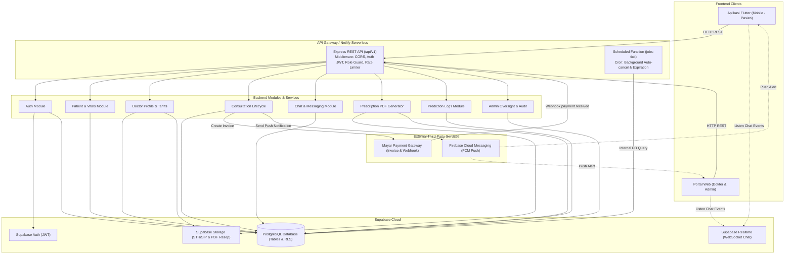
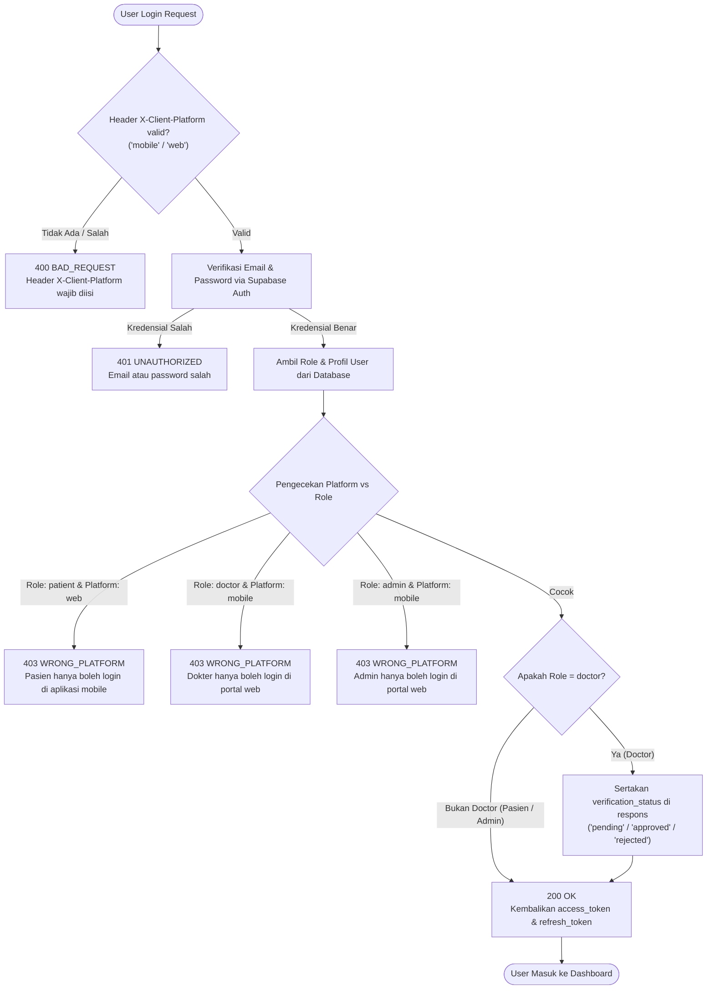
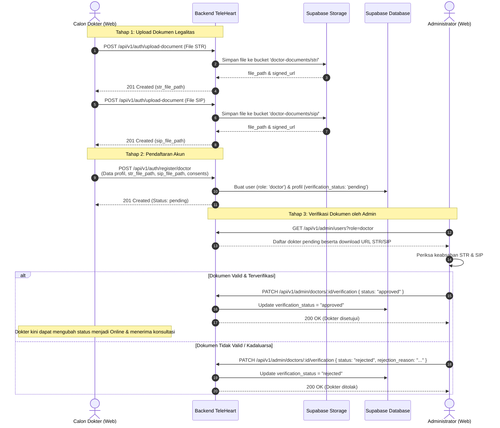
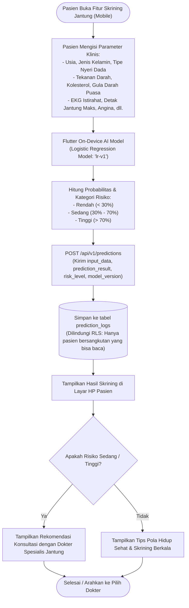
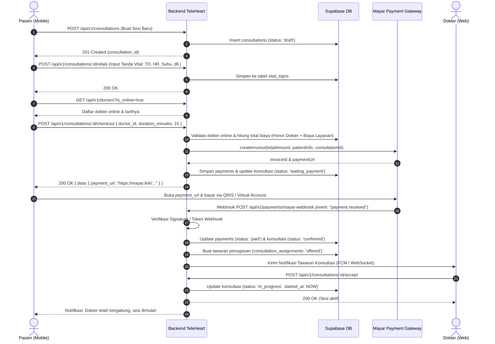
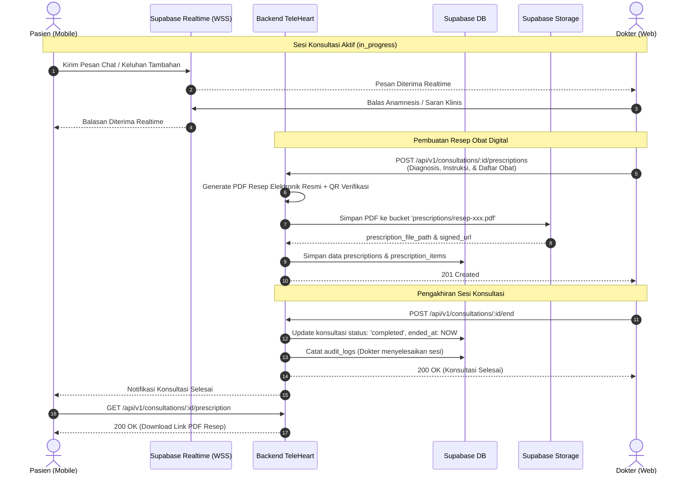
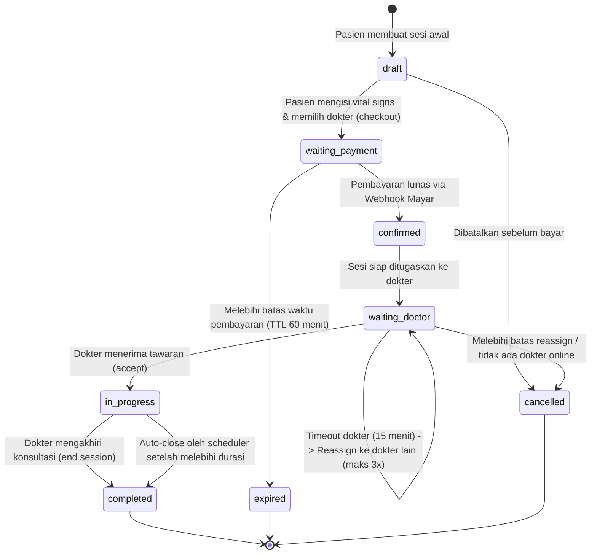
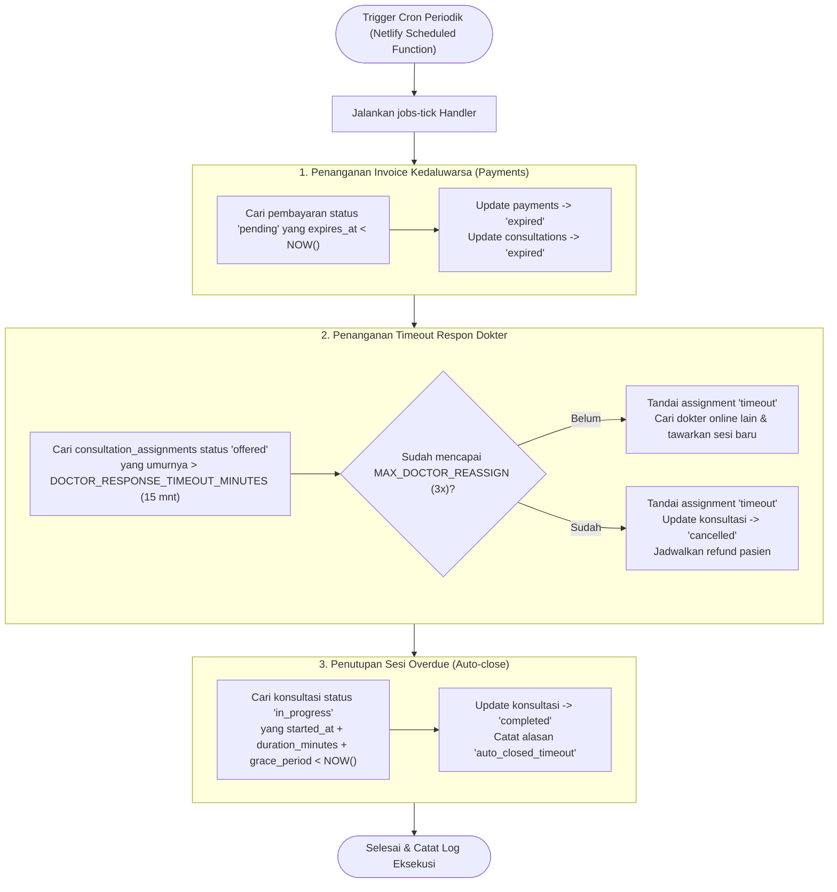

# Diagram Alur Sistem — TeleHeart

Dokumen ini memuat diagram alur (flowchart), sequence diagram, dan diagram state machine untuk sistem **TeleHeart**, mencakup arsitektur keseluruhan, autentikasi multi-platform, registrasi dokter, prediksi AI, pembayaran Mayar, chat konsultasi, hingga resep digital.

---

## Daftar Isi
1. [Arsitektur Sistem Keseluruhan](#1-arsitektur-sistem-keseluruhan)
2. [Alur Autentikasi & Validasi Platform (Role Guard)](#2-alur-autentikasi--validasi-platform-role-guard)
3. [Alur Registrasi & Verifikasi Dokter](#3-alur-registrasi--verifikasi-dokter)
4. [Alur Skrining & Prediksi Risiko Jantung AI](#4-alur-skrining--prediksi-risiko-jantung-ai)
5. [Alur Inti Konsultasi & Pembayaran (End-to-End)](#5-alur-inti-konsultasi--pembayaran-end-to-end)
6. [Alur Chat Realtime & Pembuatan Resep Digital](#6-alur-chat-realtime--pembuatan-resep-digital)
7. [State Machine Status Konsultasi](#7-state-machine-status-konsultasi)
8. [Alur Background Jobs / Schedulers (jobs-tick)](#8-alur-background-jobs--schedulers-jobs-tick)

---

## 1. Arsitektur Sistem Keseluruhan

TeleHeart membagi antarmuka menjadi aplikasi mobile untuk Pasien dan portal web untuk Dokter & Admin, dengan backend serverless berbasis Express di Netlify Functions.

---

## 2. Alur Autentikasi & Validasi Platform (Role Guard)

Setiap request login divalidasi berdasarkan header `X-Client-Platform` untuk mencegah salah kamar (Pasien login di Web atau Dokter login di Mobile).

---

## 3. Alur Registrasi & Verifikasi Dokter

Pendaftaran dokter memerlukan dua tahap: upload dokumen STR/SIP ke storage, lalu submit form data terstruktur untuk direview oleh Admin.

---

## 4. Alur Skrining & Prediksi Risiko Jantung AI

Proses inferensi AI berjalan secara lokal di perangkat pasien (on-device) untuk menjaga privasi data medis dan respon cepat tanpa ketergantungan internet saat komputasi.

---

## 5. Alur Inti Konsultasi & Pembayaran (End-to-End)

Alur bisnis sentral dari TeleHeart: pasien mengisi tanda vital, memilih dokter dan durasi, melakukan pembayaran instan via Mayar, hingga sesi konsultasi dikonfirmasi.

---

## 6. Alur Chat Realtime & Pembuatan Resep Digital

Saat konsultasi berstatus `in_progress`, pasien dan dokter bertukar pesan secara realtime. Dokter kemudian meresepkan obat dan mengakhiri sesi.

---

## 7. State Machine Status Konsultasi

Diagram transisi status konsultasi dari pembuatan awal hingga selesai atau dibatalkan.

---

## 8. Alur Background Jobs / Schedulers (`jobs-tick`)

Fungsi cron terjadwal (`netlify/functions/jobs-tick.ts`) dijalankan secara periodik untuk menjaga konsistensi transaksi dan sesi tanpa intervensi manual.

